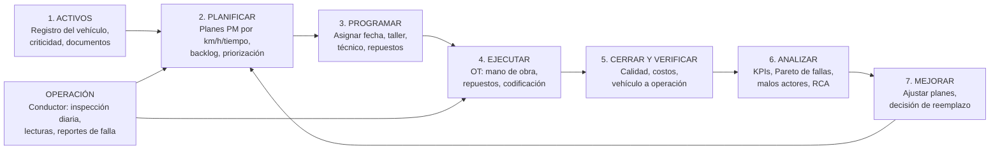

# 01 · Marco de referencia y principios del modelo

> **Modelo OLAST de Gestión de Mantenimiento y Confiabilidad de Flota (MGMC-OLAST)**
> Versión 0.1 · Estado: **Propuesta para aprobación**

## 1. Propósito

Maximizar la **disponibilidad segura** de la flota de OLAST al **menor costo total por kilómetro**, mediante un sistema de gestión de mantenimiento (CMMS) que:

1. Mantenga un registro único y confiable de cada vehículo y su historial.
2. Convierta el mantenimiento en una actividad **planificada** (meta ≥ 80 % del trabajo).
3. Capture datos de falla **codificados** que permitan decidir con evidencia (qué falla, por qué, cuánto cuesta).
4. Cumpla las obligaciones legales y de seguridad vial (inspecciones, documentos vigentes).
5. Mejore continuamente los planes de mantenimiento a partir de los datos reales.

## 2. Normas y buenas prácticas en que se basa

El modelo **no implementa una norma completa**; toma de cada una lo esencial y aplicable a una flota vehicular, para mantenerlo simple.

| Referencia | Qué tomamos para OLAST |
|---|---|
| **ISO 55000 / 55001** (Gestión de activos) | Visión de ciclo de vida del vehículo (adquisición → operación → mantenimiento → baja), alineación del mantenimiento con los objetivos del negocio, decisiones basadas en riesgo y costo. |
| **EN 13306** (Terminología de mantenimiento) | Definiciones únicas: falla, avería, mantenimiento preventivo/correctivo/basado en condición, disponibilidad, tiempo de reparación. Evita discusiones de "qué significa". |
| **ISO 14224** (Datos de confiabilidad y mantenimiento) | Estructura de captura de datos de falla: **jerarquía del activo + modo de falla + causa + acción**. Es la base para calcular MTBF/MTTR confiables. |
| **VMRS – ATA/TMC** (Vehicle Maintenance Reporting Standards) | Estándar de facto en flotas para codificar **Sistema → Conjunto → Componente** del vehículo. Usamos su *estructura*; el catálogo OLAST es propio y compatible (VMRS completo es licenciado, puede adoptarse después sin rediseñar). |
| **SAE JA1011 / JA1012** (RCM) | **RCM ligero**: solo para vehículos de criticidad A y fallas de alto impacto, definir la tarea de mantenimiento adecuada por modo de falla. |
| **SMRP – Métricas de mejores prácticas** | Definiciones y fórmulas estandarizadas de indicadores (cumplimiento PM, backlog, % planificado, MTBF, MTTR, costo de mantenimiento). |
| **TPM – Mantenimiento autónomo** | El **conductor** es el primer nivel de mantenimiento: inspección pre-operacional diaria, reporte temprano de anomalías, cuidado básico. |
| **ISO 39001** (Seguridad vial) y práctica DVIR | Inspección pre/post-viaje documentada; un defecto crítico de seguridad **inmoviliza el vehículo** hasta su reparación y verificación. |
| **ISO 31000** (Gestión del riesgo) | Matriz simple de criticidad y priorización por riesgo (probabilidad × consecuencia). |
| **ISO 9001** (Ciclo PDCA) | Ciclo de mejora continua del propio modelo y de los planes de mantenimiento. |

## 3. Principios de diseño

1. **Simple primero, completo después.** Cada módulo nace con lo mínimo que entrega valor; el modelo de datos ya contempla la expansión (no hay que rehacerlo).
2. **Un vehículo, una historia.** Todo evento (lectura, inspección, OT, costo, cambio de estado, documento) queda ligado al vehículo con fecha, kilometraje y usuario.
3. **Sin OT no hay trabajo.** Todo trabajo de mantenimiento, interno o de proveedor externo, se registra en una Orden de Trabajo (OT). Es la fuente de costos, tiempos y fallas.
4. **El dato se captura donde ocurre.** El conductor reporta desde el celular; el técnico cierra la OT en el taller. Formularios cortos, listas desplegables, foto como evidencia.
5. **Codificar, no describir.** El texto libre se complementa (no se reemplaza) con códigos de sistema, modo de falla, causa y acción. Sin códigos no hay análisis.
6. **El kilometraje es el reloj de la flota.** Los planes preventivos se disparan por km, horas motor o tiempo, *lo que ocurra primero*.
7. **La seguridad no se negocia.** Defecto crítico = vehículo fuera de servicio, bloqueado en el sistema hasta cierre verificado.
8. **Mejora basada en datos.** Los planes de mantenimiento se revisan con la evidencia de fallas y hallazgos, no por calendario fijo de por vida.

## 4. El modelo en una imagen

El ciclo combina dos flujos de entrada al trabajo:

- **Programado:** generado por los planes preventivos (PM) y las inspecciones periódicas.
- **No programado:** generado por reportes de falla del conductor, inspecciones con hallazgo, auxilio vial y siniestros.

Ambos terminan en la misma Orden de Trabajo y alimentan los mismos indicadores.

## 5. Estrategias de mantenimiento que usa OLAST

| Estrategia | Cuándo se usa | Ejemplo vehicular |
|---|---|---|
| **Preventivo por uso** (km / horas) | Desgaste proporcional al uso | Cambio de aceite y filtros cada 10 000 km |
| **Preventivo por tiempo** | Degradación por tiempo, aunque no se use | Líquido de frenos cada 24 meses, extintor anual |
| **Inspección / basado en condición** | Falla detectable antes de ocurrir | Espesor de pastillas, profundidad de banda de neumáticos, análisis de aceite |
| **Mantenimiento autónomo** (conductor) | Chequeos simples y frecuentes | Inspección pre-operacional: luces, niveles, neumáticos, frenos |
| **Correctivo planificado** | Falla detectada que no impide operar con seguridad | Reparar fuga menor detectada en inspección |
| **Correctivo de emergencia** | Falla que detiene el vehículo o compromete la seguridad | Auxilio vial por falla de motor |
| **Operar hasta fallar** (decisión consciente) | Consecuencia baja y costo de prevenir mayor que el de reparar | Bombillos de cabina, plumillas |
| **Campaña / Recall** | Indicación del fabricante o hallazgo repetitivo en un modelo | Revisión de un componente en todos los vehículos de un modelo |

## 6. Niveles de mantenimiento (quién hace qué)

| Nivel | Responsable | Alcance |
|---|---|---|
| **N1 – Operador** | Conductor | Inspección pre-operacional, limpieza, niveles, presión de neumáticos, reporte de anomalías |
| **N2 – Taller básico** | Técnico interno / lubricador | Servicios preventivos, cambios de filtros, frenos, neumáticos, ajustes |
| **N3 – Taller especializado** | Técnico interno senior o proveedor | Diagnóstico electrónico, sistemas de inyección, transmisión, suspensión |
| **N4 – Concesionario / Overhaul** | Proveedor externo / fabricante | Reparación mayor de motor/caja, garantías, recalls |

## 7. Gobernanza: rituales del modelo (ágil)

| Ritual | Frecuencia | Duración | Participantes | Salida |
|---|---|---|---|---|
| **Reunión diaria de taller** | Diaria | 15 min | Jefe de taller, técnicos, planificador | Prioridades del día, vehículos detenidos, bloqueos (repuestos, proveedor) |
| **Planificación semanal** | Semanal | 45 min | Planificador, jefe de mantenimiento, operaciones | Programa de la semana siguiente congelado; disponibilidad de vehículos acordada con operaciones |
| **Revisión de confiabilidad** | Mensual | 60 min | Jefe de mantenimiento, planificador, supervisor, finanzas (opcional) | KPIs, Pareto de fallas, top 10 vehículos "malos actores", RCA abiertos, acciones |
| **Optimización de planes PM** | Trimestral | 2 h | Jefe de mantenimiento, técnicos senior | Ajuste de frecuencias y tareas de los planes con base en hallazgos |
| **Revisión de ciclo de vida** | Anual | 2 h | Gerencia, mantenimiento, finanzas | Vehículos candidatos a reemplazo, presupuesto del año |

## 8. Disparadores de Análisis de Causa Raíz (RCA)

Para mantenerlo ágil, el RCA **no se hace a todo**. Se abre un análisis (método **5 Porqués** + diagrama de Ishikawa simplificado) cuando ocurre cualquiera de estos eventos:

1. **Falla repetitiva:** mismo vehículo + mismo sistema ≥ 3 veces en 90 días.
2. **Retrabajo:** la misma falla reaparece ≤ 30 días o ≤ 3 000 km después de una reparación.
3. **Evento de seguridad:** falla que causó o pudo causar un accidente.
4. **Alto costo:** una OT correctiva supera el umbral definido (p. ej. 5 % del valor del vehículo o un monto fijo).
5. **Falla de modelo:** el mismo modo de falla aparece en ≥ 3 vehículos del mismo modelo en 6 meses.

Cada RCA termina en **acciones** con responsable y fecha, y su cierre se verifica en la revisión mensual.
