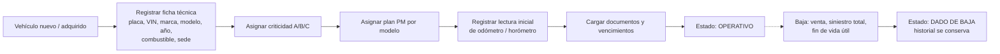
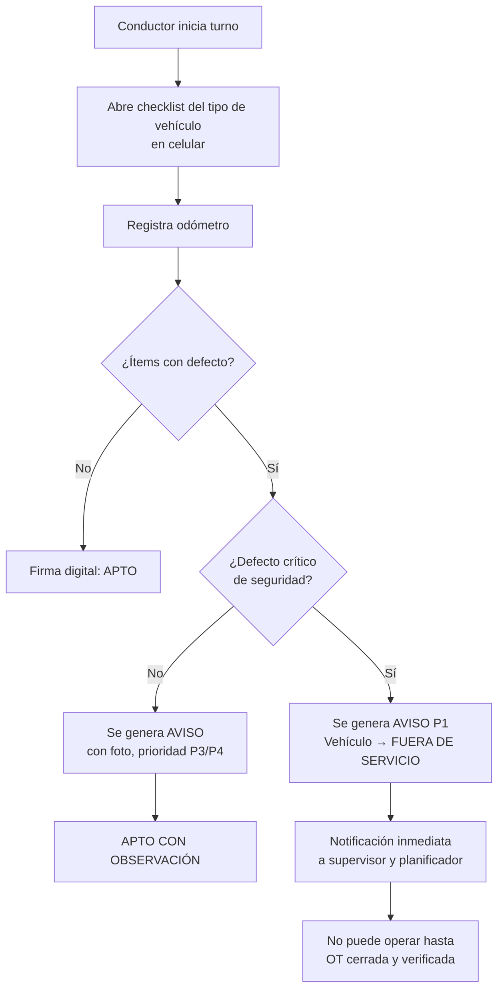
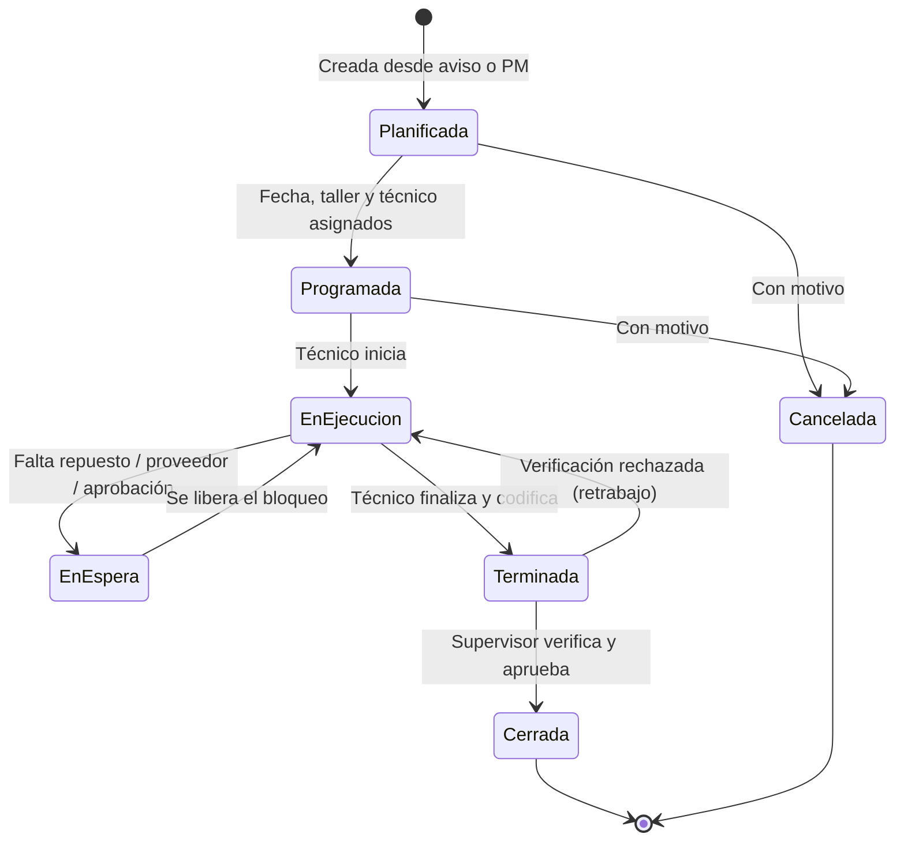

# 02 · Procesos del modelo

Cada proceso se describe con: objetivo, responsables, flujo, reglas de negocio y datos que genera. Estas reglas son **requisitos funcionales** del sistema.

---

## P1. Gestión del registro de vehículos (alta, cambios y baja)

**Objetivo:** que cada vehículo exista una sola vez, con datos completos y una criticidad asignada.
**Responsable:** Jefe de mantenimiento (aprueba), Administrador (registra).



**Reglas de negocio**
- Placa y VIN únicos. No se borra un vehículo: se da de baja (el historial se conserva para siempre).
- Un vehículo no puede pasar a OPERATIVO sin: criticidad, plan PM asignado (o marcado explícitamente "sin plan"), lectura inicial.
- **Excepción de migración:** los vehículos que ya operan se cargan con la plantilla de inventario (`tools/plantilla_flota.py` → `fleet:import`) en su estado real, aunque les falten datos. La ficha muestra los **datos pendientes** y su % de completitud. Los pendientes "requeridos para alarmas" (kilometraje, criticidad, SOAT y técnico-mecánica cuando aplica) deben completarse antes de activar el preventivo (S3).
- Los componentes de alto valor con número de serie (neumáticos, baterías, motor, caja) pueden registrarse como **componentes rastreables** que se montan/desmontan del vehículo (fase 2).

---

## P2. Registro de lecturas (odómetro / horómetro)

**Objetivo:** mantener actualizado el "reloj" que dispara el mantenimiento preventivo.
**Responsable:** Conductor (en la inspección diaria), Técnico (al abrir/cerrar OT), Integración GPS (fase 3), Combustible (fase 2).

**Reglas de negocio**
- Una lectura **no puede ser menor** que la anterior. Si lo es, se rechaza, salvo que se registre un evento de **cambio de odómetro** (con lectura final del viejo e inicial del nuevo; el sistema mantiene un *kilometraje acumulado real*).
- Alerta de **salto improbable**: si el promedio diario implícito supera un umbral configurable por tipo de vehículo (p. ej. > 1 200 km/día), la lectura queda marcada "a validar".
- Cada lectura guarda: valor, fecha-hora, fuente (inspección, OT, combustible, GPS, manual), usuario.
- Cada nueva lectura **recalcula** el vencimiento de los planes PM del vehículo.
- Alerta de **vehículo sin lectura** por más de N días (configurable, p. ej. 7) → la previsión de PM pierde confianza.

---

## P3. Inspección pre-operacional (mantenimiento autónomo / DVIR)

**Objetivo:** detectar defectos antes de operar y cumplir la obligación de seguridad vial.
**Responsable:** Conductor (ejecuta), Supervisor de taller (revisa hallazgos).



**Reglas de negocio**
- Checklist **por tipo de vehículo** (liviano, carga, bus, maquinaria), con ítems Sí/No/N.A. y cada ítem marcado si es **crítico** (frenos, dirección, luces, neumáticos, cinturones, fugas de combustible, etc.).
- Un ítem crítico con defecto bloquea el vehículo automáticamente (estado FUERA DE SERVICIO).
- Defectos ya reportados y abiertos se muestran al conductor siguiente (evita duplicados: "este defecto ya está reportado en el aviso #123").
- Tiempo objetivo de llenado: **≤ 3 minutos**.
- KPI: % de cumplimiento de inspecciones diarias por vehículo que operó.

---

## P4. Aviso (solicitud de mantenimiento / reporte de falla)

**Objetivo:** capturar toda necesidad de mantenimiento en un único punto de entrada.
**Origen:** inspección, conductor (reporte directo), técnico (hallazgo en OT), auxilio vial, siniestro.

**Flujo:** `NUEVO → EN REVISIÓN → APROBADO (genera OT) | RECHAZADO (motivo) | AGRUPADO (se suma a OT existente)`

**Reglas de negocio**
- Datos mínimos: vehículo, descripción, sistema afectado (lista), ¿el vehículo puede operar? (Sí / Con restricción / No), foto opcional, lectura de odómetro.
- El supervisor/planificador asigna **prioridad** según la matriz (ver [03-catalogos](03-catalogos-y-codificacion.md#3-matriz-de-prioridad)).
- Un aviso puede convertirse en OT, agregarse a una OT existente del mismo vehículo, o rechazarse con justificación (nunca se elimina).
- **Tiempo de respuesta** medido desde la creación del aviso hasta el inicio de la OT.

---

## P5. Planificación del mantenimiento preventivo (PM)

**Objetivo:** que el sistema genere automáticamente el trabajo preventivo a tiempo.
**Responsable:** Planificador.

**Conceptos**
- **Plan de mantenimiento:** conjunto de *rutinas* aplicable a un modelo/tipo de vehículo (p. ej. "Plan Camión Marca X Modelo Y").
- **Rutina (servicio):** grupo de tareas con un disparador. Ej.: "Servicio A – cada 10 000 km o 6 meses".
- **Tarea:** actividad concreta con tiempo estándar, nivel de técnico y repuestos sugeridos (kit). Ej.: "Cambiar filtro de aceite – 0,3 h – kit FLT-01".
- **Disparador:** km, horas motor, días, **lo que ocurra primero**. Opcional: *rutinas anidadas* (el servicio C de 30 000 km incluye las tareas del A y B → se ejecuta solo el de mayor nivel).

**Cálculo del vencimiento** (por vehículo y rutina)

```
próximo_km    = km_última_ejecución   + intervalo_km
próxima_fecha = fecha_última_ejecución + intervalo_días
vencimiento   = el primero que se alcance, proyectando el km con el uso promedio diario de los últimos 30 días
```

- Se usa **última ejecución real** (programación flotante): si un servicio se hizo tarde, el siguiente se cuenta desde que se hizo.
- **Ventana de tolerancia** (configurable, por defecto ±10 % del intervalo): define si un PM se ejecutó "a tiempo" para el KPI de cumplimiento.

**Estados del pronóstico por vehículo-rutina**

| Estado | Condición (por defecto) | Acción del sistema |
|---|---|---|
| 🟢 Al día | < 80 % del intervalo consumido | Ninguna |
| 🟡 Próximo | ≥ 80 % y < 90 % | Visible en tablero de previsión |
| 🟠 Generar OT | ≥ 90 % | **Genera OT preventiva automáticamente** en estado PLANIFICADA |
| 🔴 Vencido | > 100 % + tolerancia | Alerta al jefe de mantenimiento; afecta KPI |

**Reglas de negocio**
- Al cerrar una OT preventiva, la lectura y fecha de cierre actualizan la "última ejecución" de la rutina (y de las rutinas anidadas inferiores).
- No se generan OT duplicadas: si ya hay una OT abierta para esa rutina y vehículo, no se crea otra.
- Las tareas que no se pudieron hacer en una OT preventiva quedan como **pendiente** y generan aviso.

---

## P6. Programación semanal

**Objetivo:** comprometer un programa realista con operaciones.
**Responsable:** Planificador, con validación de Operaciones.

1. **Jueves:** el planificador revisa el backlog (OT planificadas y listas: con repuestos y recursos disponibles).
2. Ordena por **prioridad → criticidad del vehículo → antigüedad de la OT**.
3. Asigna fecha, taller (interno/proveedor) y técnico, sin superar el **80–90 % de la capacidad** disponible de horas-hombre (se deja margen para emergencias).
4. Acuerda con Operaciones la **liberación de vehículos** (ventanas de parada).
5. **Viernes:** el programa queda congelado. KPI: **cumplimiento del programa** (OT programadas ejecutadas en la semana / OT programadas).

---

## P7. Orden de Trabajo (OT): ejecución y cierre

**Objetivo:** registrar todo trabajo con su costo, tiempo y código de falla.
**Responsables:** Planificador (crea/programa), Técnico (ejecuta y registra), Supervisor (verifica y cierra).



**Datos que se registran en la OT**
- Cabecera: número, vehículo, tipo de OT, prioridad, origen (aviso/PM), taller (interno/proveedor), lectura de odómetro al ingreso.
- **Tareas** (de la rutina PM o agregadas) con estado: hecha / no hecha (motivo) / hallazgo.
- **Mano de obra:** técnico, horas reales (inicio–fin o cantidad), costo hora.
- **Repuestos y materiales:** artículo, cantidad, costo unitario (de inventario o factura de proveedor).
- **Servicios externos:** proveedor, número de factura, monto.
- **Codificación de cierre (obligatoria en correctivos):** sistema → conjunto → componente, modo de falla, causa, acción realizada (ver [03-catalogos](03-catalogos-y-codificacion.md#4-codificación-de-fallas)).
- Observaciones, fotos, adjuntos (facturas, diagnósticos).
- **Tiempos clave** (automáticos): creación, inicio, entradas/salidas de "En espera" con motivo, fin, cierre.

**Reglas de negocio**
- Una OT correctiva **no puede pasar a TERMINADA** sin codificación completa.
- Al cerrar una OT que nació de un defecto crítico, el supervisor debe **verificar** (prueba funcional) antes de devolver el vehículo a OPERATIVO.
- El costo total de la OT = mano de obra + repuestos + servicios externos. Una OT cerrada no se edita; se corrige mediante un ajuste trazable (auditoría).
- Un **hallazgo** durante una OT (p. ej. en un preventivo se detecta desgaste de pastillas) se registra como nuevo aviso ligado, para no mezclar costos preventivos con correctivos.
- Si el vehículo reingresa por la misma falla (mismo vehículo + mismo componente) dentro de 30 días o 3 000 km, la nueva OT se marca automáticamente como **RETRABAJO** y se liga a la OT original.

---

## P8. Gestión del estado del vehículo y tiempo fuera de servicio

**Objetivo:** medir la disponibilidad real con precisión.

| Estado | Significado | ¿Cuenta como no disponible? |
|---|---|---|
| OPERATIVO | Disponible sin restricciones | No |
| OPERATIVO CON RESTRICCIÓN | Puede operar con limitaciones (p. ej. solo urbano) | No (se reporta aparte) |
| FUERA DE SERVICIO – MANTENIMIENTO | En taller, preventivo o correctivo | **Sí** |
| FUERA DE SERVICIO – ESPERA DE REPUESTO | Detenido por falta de repuesto/proveedor | **Sí** |
| FUERA DE SERVICIO – SINIESTRO | Accidente, en reparación de colisión | **Sí** (indicador separado) |
| FUERA DE SERVICIO – ADMINISTRATIVO | Documentos vencidos, retención legal | **Sí** (indicador separado) |
| RESERVA | Disponible pero sin asignación operativa | No |
| DADO DE BAJA | Fuera de la flota | Excluido de cálculos |

**Reglas de negocio**
- Cada cambio de estado se registra con fecha-hora, usuario, motivo y OT asociada. La disponibilidad se calcula **a partir de este historial**, no de estimaciones.
- Los cambios de estado pueden ser automáticos (inspección crítica, inicio/cierre de OT, documento vencido) o manuales con motivo.

---

## P9. Control de documentos y vencimientos

**Objetivo:** que ningún vehículo opere con documentos vencidos.
**Responsable:** Administrador de flota.

- Tipos de documento configurables por país/tipo de vehículo: seguro obligatorio, póliza todo riesgo, revisión técnica/técnico-mecánica, permiso de operación, tarjeta de propiedad, certificado de gases, extintor, etc.
- Cada documento: número, emisor, fecha de emisión, **fecha de vencimiento**, archivo adjunto.
- Alertas a 30, 15 y 7 días (configurable). Al vencer: el vehículo pasa a FUERA DE SERVICIO – ADMINISTRATIVO (configurable por tipo de documento: bloqueante o solo alerta).
- Fase 2: licencias y certificaciones de conductores.

---

## P10. Análisis y mejora (confiabilidad)

**Objetivo:** cerrar el ciclo PDCA.
**Responsable:** Jefe de mantenimiento.

1. **Pareto mensual** de fallas por sistema, por costo y por tiempo fuera de servicio.
2. **Top 10 "malos actores":** vehículos con mayor costo/km o mayor número de fallas → decisión: RCA, plan especial o evaluación de reemplazo.
3. **RCA** según los disparadores definidos en [01-marco](01-marco-y-principios.md#8-disparadores-de-análisis-de-causa-raíz-rca); acciones con responsable y fecha.
4. **Optimización PM trimestral:**
   - Tareas que **nunca** generan hallazgos → evaluar extender intervalo o eliminar.
   - Fallas que ocurren **antes** del intervalo PM → acortar intervalo o agregar inspección.
   - Fallas sin tarea preventiva que las prevenga y con alta consecuencia → aplicar RCM ligero para definir tarea.
5. **Decisión de reemplazo (anual):** comparar costo acumulado de mantenimiento por km contra el costo de un vehículo nuevo (análisis de costo de ciclo de vida, LCC). Regla orientativa: evaluar reemplazo cuando el costo anual de mantenimiento supere el 30–40 % del valor de mercado del vehículo, o cuando la disponibilidad sea consistentemente < 85 %.

---

## P11. Repuestos e inventario (MVP básico → fase 2 completo)

- **MVP:** catálogo de artículos (código, descripción, unidad, costo de referencia, números de parte equivalentes, modelos compatibles) y **consumo** en la OT. Kits de repuestos asociados a tareas PM.
- **Fase 2:** almacenes por sede, existencias, entradas/salidas, mínimos/máximos, punto de reorden, solicitud de compra, recepción, valorización a costo promedio, conteo cíclico, criticidad del repuesto (ABC).

---

## P12. Combustible (fase 2)

- Registro de cargas (fecha, vehículo, litros/galones, costo, odómetro, estación/proveedor, conductor) manual o por importación de archivo de la tarjeta de combustible.
- KPI de rendimiento (km/L o km/gal) por vehículo vs. su modelo; alerta por desviación > 15 % (puede indicar falla mecánica, mala conducción o fuga/fraude).
- La lectura de odómetro de la carga alimenta P2.

---

## P13. Neumáticos (fase 2)

- Neumático como componente rastreable con número de serie/fuego: marca, medida, posición, profundidad de banda inicial.
- Montaje/desmontaje/rotación/reencauche con lectura de km → **costo por km por neumático** y vida útil por marca.
- Inspección periódica de profundidad y presión; alerta por profundidad mínima legal.
