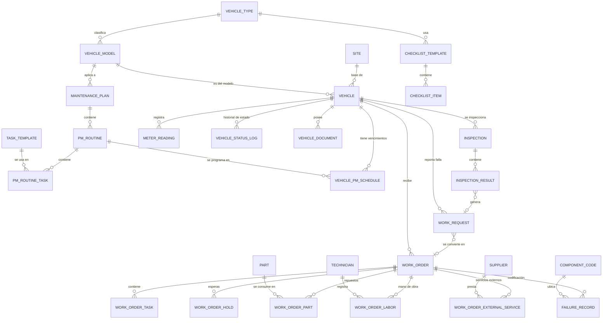

# 04 · Modelo de datos

**Convención:** el código y la base de datos se escriben en **inglés** (nombres de tablas y campos en `snake_case`); la interfaz de usuario está en **español**. La tabla de equivalencias está en la sección 5.

**Campos comunes a todas las tablas** (no se repiten abajo):
`id` (UUID) · `created_at` · `updated_at` · `created_by` · `updated_by` · `deleted_at` (borrado lógico, solo en maestros).

**Escalabilidad prevista desde el día 1:**
- `organization_id` en las tablas principales (permite multiempresa a futuro sin migración mayor; en el MVP existe una sola organización: OLAST).
- `site_id` (sede/base) en vehículos, usuarios, talleres y almacenes.
- Campo `attributes` (JSONB) en `vehicles` y `vehicle_models` para datos técnicos variables por tipo sin alterar el esquema.
- Tabla de auditoría genérica para todos los cambios.

## 1. Diagrama entidad–relación (núcleo MVP)

## 2. Entidades y campos clave

### 2.1 Organización y seguridad

| Tabla | Campos clave |
|---|---|
| `organizations` | `name`, `tax_id`, `country_code`, `currency`, `distance_unit` (km/mi), `volume_unit` (L/gal), `timezone` |
| `sites` | `organization_id`, `code`, `name`, `address`, `active` |
| `users` | `organization_id`, `site_id`, `email`, `full_name`, `phone`, `role`, `active`, `last_login_at` |
| `technicians` | `user_id` (nullable: técnicos sin usuario), `name`, `level` (N2/N3), `hourly_cost`, `site_id`, `active` |
| `drivers` | `user_id` (nullable), `name`, `document_id`, `license_number`, `license_category`, `license_expiry`, `site_id` |
| `audit_log` | `entity`, `entity_id`, `action` (create/update/delete/status_change), `diff` (JSONB), `user_id`, `timestamp` |

### 2.2 Activos

| Tabla | Campos clave |
|---|---|
| `vehicle_types` | `code` (LIV, CAR…), `name`, `primary_meter` (odometer/hourmeter), `max_daily_usage` (validación) |
| `vehicle_models` | `vehicle_type_id`, `make`, `model`, `year_from`, `year_to`, `fuel_type`, `attributes` (JSONB) |
| `vehicles` | `organization_id`, `site_id`, `internal_code` (nro. interno), `plate` (único), `vin` (único), `vehicle_model_id`, `year`, `color`, `fuel_type`, `criticality` (A/B/C), `criticality_score` (JSON con los 4 criterios), `status` (actual), `ownership` (propio/arrendado), `acquisition_date`, `acquisition_cost`, `in_service_date`, `current_odometer`, `current_hourmeter`, `odometer_offset` (por cambio de odómetro), `assigned_driver_id`, `cost_center`, `attributes` (JSONB), `retired_at`, `retirement_reason` |
| `vehicle_status_log` | `vehicle_id`, `status`, `reason`, `started_at`, `ended_at`, `work_order_id` (nullable), `user_id`, `source` (auto/manual) |
| `meter_readings` | `vehicle_id`, `meter_type`, `value`, `accumulated_value`, `read_at`, `source` (inspection/work_order/fuel/gps/manual), `is_flagged`, `flag_reason`, `user_id` |
| `meter_replacements` | `vehicle_id`, `meter_type`, `old_final_value`, `new_initial_value`, `replaced_at`, `reason` |
| `document_types` | `code`, `name`, `is_blocking` (bloquea al vencer), `alert_days` (ej. [30,15,7]) |
| `vehicle_documents` | `vehicle_id`, `document_type_id`, `number`, `issuer`, `issued_at`, `expires_at`, `file_id` |

### 2.3 Mantenimiento preventivo

| Tabla | Campos clave |
|---|---|
| `task_templates` | `code`, `description`, `component_code_id`, `standard_hours`, `required_level`, `instructions`, `requires_measurement` (ej. espesor), `measurement_unit` |
| `maintenance_plans` | `name`, `vehicle_model_id` o `vehicle_type_id`, `active`, `version` |
| `pm_routines` | `maintenance_plan_id`, `code` (A/B/C), `name`, `interval_distance`, `interval_hours`, `interval_days`, `tolerance_pct`, `generate_at_pct` (90), `includes_routine_ids` (rutinas anidadas), `work_order_type` (PM/INS) |
| `pm_routine_tasks` | `pm_routine_id`, `task_template_id`, `sequence`, `part_kit` (lista de `part_id` + cantidad) |
| `vehicle_pm_schedules` | `vehicle_id`, `pm_routine_id`, `last_done_at`, `last_done_meter`, `next_due_meter`, `next_due_date`, `projected_due_date`, `pct_consumed`, `status` (ok/upcoming/due/overdue), `open_work_order_id` |

### 2.4 Inspecciones

| Tabla | Campos clave |
|---|---|
| `checklist_templates` | `vehicle_type_id`, `name`, `kind` (pre_trip/post_trip/periodic), `version`, `active` |
| `checklist_items` | `checklist_template_id`, `sequence`, `text`, `component_code_id`, `is_critical`, `requires_photo_on_fail` |
| `inspections` | `vehicle_id`, `checklist_template_id`, `driver_id`, `performed_at`, `odometer`, `result` (fit/fit_with_observations/unfit), `signature`, `geo_location` (opcional) |
| `inspection_results` | `inspection_id`, `checklist_item_id`, `answer` (ok/defect/na), `comment`, `photo_file_id`, `work_request_id` |

### 2.5 Avisos y Órdenes de Trabajo

| Tabla | Campos clave |
|---|---|
| `work_requests` | `number` (correlativo legible), `vehicle_id`, `source` (inspection/driver/technician/roadside/accident), `description`, `component_code_id` (sistema, nivel 1 mínimo), `can_operate` (yes/restricted/no), `priority`, `status` (new/in_review/approved/rejected/merged), `rejection_reason`, `work_order_id`, `reported_by`, `reported_at`, `odometer` |
| `work_orders` | `number` (correlativo, ej. OT-2026-000123), `vehicle_id`, `type` (PM/INS/PDM/CP/CE/AUX/SIN/MEJ/CAM), `priority`, `status`, `origin` (request/pm/campaign/manual), `pm_routine_id`, `campaign_id`, `workshop_type` (internal/external), `supplier_id`, `site_id`, `description`, `odometer_in`, `odometer_out`, `planned_start`, `planned_end`, `actual_start`, `actual_end`, `closed_at`, `closed_by`, `verified_by`, `is_rework`, `rework_of_id`, `estimated_cost`, `labor_cost`, `parts_cost`, `external_cost`, `total_cost` (calculado), `cancel_reason` |
| `work_order_tasks` | `work_order_id`, `task_template_id` (nullable), `description`, `sequence`, `status` (pending/done/not_done/finding), `not_done_reason`, `measurement_value`, `comment` |
| `work_order_labor` | `work_order_id`, `technician_id`, `started_at`, `ended_at`, `hours`, `hourly_cost`, `cost` |
| `work_order_parts` | `work_order_id`, `part_id` (nullable si es compra directa), `description`, `quantity`, `unit_cost`, `total_cost`, `source` (stock/direct_purchase) |
| `work_order_external_services` | `work_order_id`, `supplier_id`, `description`, `invoice_number`, `amount` |
| `work_order_holds` | `work_order_id`, `reason` (REPUESTO/PROVEEDOR/…), `started_at`, `ended_at`, `comment` |
| `failure_records` | `work_order_id`, `component_code_id` (hasta nivel 3), `failure_mode_code`, `cause_code`, `action_code`, `comment` |
| `attachments` | `entity`, `entity_id`, `file_id`, `kind` (photo/invoice/report) |
| `files` | `storage_key`, `filename`, `mime_type`, `size`, `uploaded_by` |

### 2.6 Catálogos de codificación

| Tabla | Campos clave |
|---|---|
| `component_codes` | `code` (ej. `FRN.PAS.DEL`), `name`, `level` (1/2/3), `parent_id`, `vmrs_code` (opcional) |
| `failure_modes` | `code`, `name` |
| `failure_causes` | `code`, `name` |
| `repair_actions` | `code`, `name` |
| `hold_reasons` | `code`, `name` |

### 2.7 Repuestos y proveedores

| Tabla | Campos clave |
|---|---|
| `parts` | `code`, `description`, `unit`, `reference_cost`, `manufacturer_part_numbers` (array), `compatible_model_ids`, `criticality`, `active` |
| `suppliers` | `name`, `tax_id`, `kind` (workshop/parts/dealer/tires/fuel), `contact`, `phone`, `email`, `active` |
| *(Fase 2)* `warehouses`, `stock_levels`, `stock_movements`, `purchase_requests` | Inventario completo |

### 2.8 Fase 2 y 3 (previstas, no se construyen en MVP)

`fuel_transactions`, `tires`, `tire_events`, `tracked_components` + `component_installations`, `campaigns` + `campaign_vehicles`, `rca_analyses` + `rca_actions`, `budgets`, `telematics_events`, `fault_codes_dtc`.

## 3. Reglas de integridad críticas

1. `meter_readings.value` debe ser ≥ última lectura del mismo vehículo y tipo de medidor (salvo `meter_replacements`).
2. Solo un registro abierto (`ended_at IS NULL`) por vehículo en `vehicle_status_log`; `vehicles.status` es un reflejo denormalizado del registro abierto, actualizado en la misma transacción.
3. Solo una OT abierta por (`vehicle_id`, `pm_routine_id`).
4. `work_orders.total_cost` = suma de mano de obra + repuestos + servicios externos (calculado en servicio, persistido para consulta rápida).
5. OT correctivas (`CP`, `CE`, `AUX`) requieren al menos un `failure_record` completo para pasar a `completed`.
6. Las transiciones de estado de OT se validan en una **máquina de estados** en el backend (no en el frontend).
7. Numeración correlativa sin huecos por organización y año para avisos y OT (secuencia en base de datos).

## 4. Datos calculados / vistas para indicadores

- `v_vehicle_availability_daily`: horas disponibles vs. fuera de servicio por vehículo y día, derivadas de `vehicle_status_log`.
- `v_work_order_kpis`: tiempos (respuesta, reparación, espera por motivo) por OT.
- `v_pm_compliance`: cada OT PM cerrada con su desviación respecto a la ventana de tolerancia.
- `v_cost_per_km`: costo de mantenimiento por vehículo y mes / km recorridos en el mes.
- `v_failures`: fallas con su jerarquía de componentes para Pareto y MTBF.

Inicialmente son **vistas SQL**; si crece el volumen, se convierten en vistas materializadas o tablas de agregados actualizadas por trabajos programados.

## 5. Glosario de equivalencias (UI ↔ código)

| Español (UI) | Inglés (código) |
|---|---|
| Sede / base | `site` |
| Vehículo | `vehicle` |
| Lectura (odómetro/horómetro) | `meter_reading` |
| Plan de mantenimiento | `maintenance_plan` |
| Rutina / servicio | `pm_routine` |
| Tarea estándar | `task_template` |
| Vencimiento de PM | `vehicle_pm_schedule` |
| Inspección pre-operacional | `inspection` (`pre_trip`) |
| Aviso / solicitud | `work_request` |
| Orden de Trabajo (OT) | `work_order` |
| Espera | `work_order_hold` |
| Codificación de falla | `failure_record` |
| Repuesto | `part` |
| Proveedor | `supplier` |
| Documento / vencimiento | `vehicle_document` |
